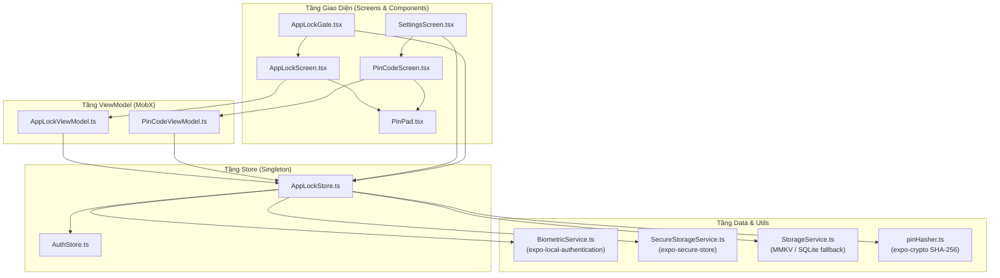
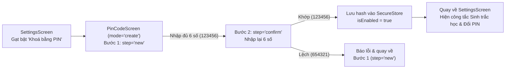
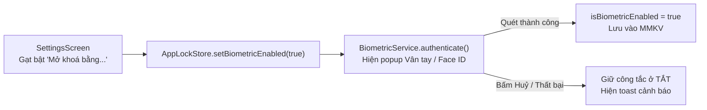
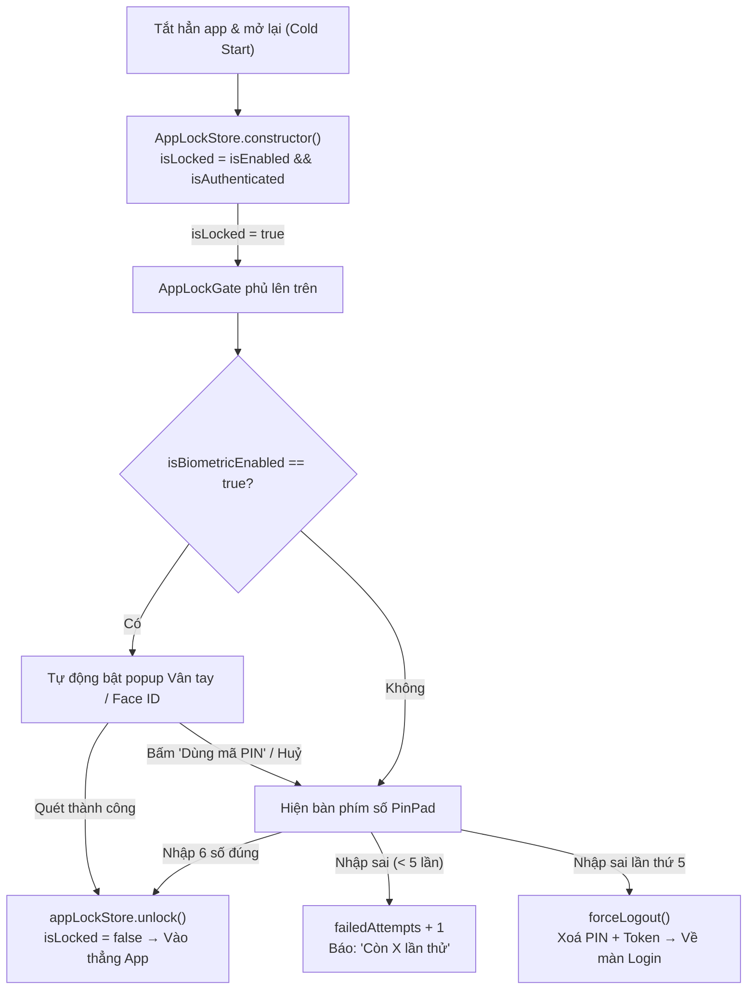
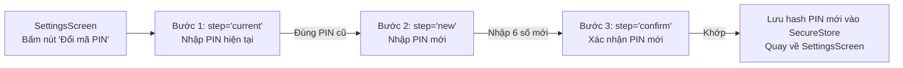
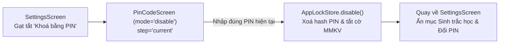

# TÀI LIỆU KỸ THUẬT: TÍNH NĂNG KHOÁ ỨNG DỤNG (APP LOCK — PIN & BIOMETRIC AUTHENTICATION)

---

## MỤC LỤC
1. [Tổng Quan & Phạm Vi Triển Khai](#1-tổng-quan--phạm-vi-triển-khai)
2. [Kiến Trúc & Cấu Trúc Mã Nguồn](#2-kiến-trúc--cấu-trúc-mã-nguồn)
3. [Chi Tiết Các Dịch Vụ, Store & Hàm Cốt Lõi](#3-chi-tiết-các-dịch-vụ-store--hàm-cốt-lõi)
   * [3.1. `pinHasher` — Băm mã PIN kèm Salt (SHA-256)](#31-pinhasher--băm-mã-pin-kèm-salt-sha-256)
   * [3.2. `SecureStorageService` — Lưu trữ bảo mật phần cứng](#32-securestorageservice--lưu-trữ-bảo-mật-phần-cứng)
   * [3.3. `BiometricService` — Giao tiếp phần cứng Sinh trắc học](#33-biometricservice--giao-tiếp-phần-cứng-sinh-trắc-học)
   * [3.4. `AppLockStore` — Quản lý trạng thái khoá toàn ứng dụng](#34-applockstore--quản-lý-trạng-thái-khoá-toàn-ứng-dụng)
   * [3.5. `AppLockGate` & Các Màn Hình UI (`AppLockScreen`, `PinCodeScreen`, `SettingsScreen`)](#35-applockgate--các-màn-hình-ui-applockscreen-pincodescreen-settingsscreen)
4. [Đặc Tả Chi Tiết 6 Luồng Nghiệp Vụ (End-to-End Flows)](#4-đặc-tả-chi-tiết-6-luồng-nghiệp-vụ-end-to-end-flows)
   * [Luồng 1: Thiết lập mã PIN lần đầu (`mode: "create"`)](#luồng-1-thiết-lập-mã-pin-lần-đầu-mode-create)
   * [Luồng 2: Bật mở khoá bằng Sinh trắc học trong Cài đặt](#luồng-2-bật-mở-khoá-bằng-sinh-trắc-học-trong-cài-đặt)
   * [Luồng 3: Mở lại App (Cold Start) → Mở khoá bằng Sinh trắc học hoặc PIN](#luồng-3-mở-lại-app-cold-start--mở-khoá-bằng-sinh-trắc-học-hoặc-pin)
   * [Luồng 4: Đổi mã PIN (`mode: "change"`)](#luồng-4-đổi-mã-pin-mode-change)
   * [Luồng 5: Tắt khoá ứng dụng (`mode: "disable"`)](#luồng-5-tắt-khoá-ứng-dụng-mode-disable)
   * [Luồng 6: Quên mã PIN / Nhập sai quá 5 lần / Đăng xuất](#luồng-6-quên-mã-pin--nhập-sai-quá-5-lần--đăng-xuất)
5. [Lưu Ý Kỹ Thuật & Giải Đáp Các Câu Hỏi Trọng Tâm (Q&A)](#5-lưu-ý-kỹ-thuật--giải-đáp-các-câu-hỏi-trọng-tâm-qa)
6. [Hướng Dẫn Kiểm Thử & Đóng Gói Bản Build (APK / iOS)](#6-hướng-dẫn-kiểm-thử--đóng-gói-bản-build-apk--ios)

---

## 1. TỔNG QUAN & PHẠM VI TRIỂN KHAI

### 1.1. Yêu cầu nghiệp vụ
Triển khai cơ chế bảo mật lớp thứ hai (tương tự ứng dụng ngân hàng/ví điện tử) cho phép người dùng đã đăng nhập:
- **Bật/tắt khoá ứng dụng bằng mã PIN 6 chữ số riêng của ứng dụng** (độc lập với mật khẩu mở khoá thiết bị).
- **Tích hợp xác thực sinh trắc học** (Face ID / Touch ID trên iOS; Vân tay / Khuôn mặt trên Android) làm phương thức mở khoá nhanh.
- **Tự động khoá ứng dụng khi mở lại (Cold Start):** Mỗi khi khởi động lại ứng dụng, yêu cầu xác thực sinh trắc học hoặc nhập mã PIN 6 số trước khi vào màn hình chính.
- **Cơ chế chống dò mã PIN (Brute-force protection):** Giới hạn tối đa **5 lần** nhập sai liên tiếp (bộ đếm được lưu bền vững xuống bộ nhớ máy). Nhập sai lần thứ 5 sẽ tự động xoá phiên đăng nhập và buộc đăng nhập lại bằng tài khoản.

### 1.2. Các thư viện sử dụng (Android & iOS)

| Thư viện | Phiên bản | Vai trò trong tính năng | Nền tảng hỗ trợ |
|---|---|---|---|
| `expo-local-authentication` | `~57.0.3` | Gọi API sinh trắc học gốc của hệ điều hành (`BiometricPrompt` trên Android, `LocalAuthentication` / `LAContext` trên iOS) | Android, iOS |
| `expo-secure-store` | `~57.0.4` | Lưu trữ chuỗi băm (hash) của mã PIN trong vùng nhớ mã hoá phần cứng (Android Keystore / iOS Keychain) | Android, iOS |
| `expo-crypto` | `~57.0.3` | Sinh salt ngẫu nhiên 16 byte và băm mã PIN bằng thuật toán `SHA-256` trước khi lưu | Android, iOS |
| `react-native-mmkv` | `3.3.3` | Đọc/ghi đồng bộ (synchronous) các cờ trạng thái không nhạy cảm (`isEnabled`, `isBiometricEnabled`, `failedAttempts`) ngay lúc khởi động app | Android, iOS |

---

## 2. KIẾN TRÚC & CẤU TRÚC MÃ NGUỒN

Tính năng tuân thủ nghiêm ngặt kiến trúc **MVVM + InversifyJS Dependency Injection + MobX** của dự án:



### Danh mục các file triển khai

| Đường dẫn File | Phân loại | Trách nhiệm chính |
|---|---|---|
| `app/utils/pinHasher.ts` | Utility | Sinh salt 16 byte ngẫu nhiên, băm SHA-256 và đối chiếu mã PIN (`<saltHex>:<hashHex>`) |
| `app/data/local/secure/SecureStorageService.ts` | Data Service | Wrapper `@injectable()` quanh `expo-secure-store` để lưu/đọc/xoá `pinHash` trong Keychain/Keystore |
| `app/data/local/biometric/BiometricService.ts` | Data Service | Wrapper `@injectable()` quanh `expo-local-authentication` để kiểm tra phần cứng và gọi popup sinh trắc học |
| `app/stores/appLockStore.ts` | MobX Store | Singleton quản lý toàn bộ trạng thái khoá (`isEnabled`, `isBiometricEnabled`, `isLocked`, `failedAttempts`) |
| `app/components/PinPad/PinPad.tsx` | UI Component | Bàn phím số 3×4 tự vẽ (không dùng bàn phím hệ thống) + dãy 6 chấm tròn hiển thị tiến độ nhập PIN |
| `app/screens/PinCode/PinCodeViewModel.ts` | ViewModel | Máy trạng thái (State Machine) điều khiển 3 chế độ: Tạo PIN (`create`), Đổi PIN (`change`), Tắt PIN (`disable`) |
| `app/screens/PinCode/PinCodeScreen.tsx` | Screen | Màn hình nhập/xác nhận PIN khi đi từ Cài đặt sang |
| `app/screens/AppLock/AppLockViewModel.ts` | ViewModel | Logic mở khoá ứng dụng lúc Cold Start (tự gọi sinh trắc học, kiểm tra PIN, đếm số lần sai) |
| `app/screens/AppLock/AppLockScreen.tsx` | Screen | Màn hình khoá phủ toàn màn hình, chặn nút Back Android, hỗ trợ nút "Quên mã PIN?" |
| `app/navigators/AppLockGate.tsx` | Gate | Component `observer` gắn ở `app.tsx`, tự động hiển thị `<AppLockScreen />` đè lên `<AppNavigator />` khi `isLocked = true` |
| `app/screens/Settings/SettingsScreen.tsx` | Screen | Bổ sung mục **Bảo mật**: công tắc khoá PIN, công tắc sinh trắc học, nút đổi PIN, nút khoá thử nghiệm |
| `app/di/modules/dataModule.ts` | DI Module | Đăng ký singleton `SecureStorageService`, `BiometricService`, `AppLockStore` |
| `app/di/modules/viewModelModule.ts` | DI Module | Đăng ký `AppLockViewModel`, `PinCodeViewModel` |
| `app/i18n/vi.ts` & `app/i18n/en.ts` | Localization | Từ điển đa ngôn ngữ Việt / Anh cho toàn bộ luồng khoá ứng dụng |
| `app/stores/appLockStore.test.ts` | Unit Test | Kiểm thử Cold Start lock, xác thực PIN, đếm số lần sai, bật sinh trắc học và `forceLogout` |
| `app/screens/AppLock/AppLockViewModel.test.ts` | Unit Test | Kiểm thử ViewModel màn hình khoá |
| `app/screens/PinCode/PinCodeViewModel.test.ts` | Unit Test | Kiểm thử ViewModel tạo / đổi / tắt PIN |

---

## 3. CHI TIẾT CÁC DỊCH VỤ, STORE & HÀM CỐT LÕI

### 3.1. `pinHasher` — Băm mã PIN kèm Salt (`app/utils/pinHasher.ts`)
Không bao giờ lưu mã PIN gốc (ví dụ `"123456"`) xuống thiết bị.
- **`hash(pin)`**:
  1. Gọi `Crypto.getRandomBytes(16)` tạo 16 byte ngẫu nhiên và đổi sang chuỗi hex (ví dụ `"4f9a..."`).
  2. Ghép `"4f9a...:123456"` rồi băm bằng `Crypto.digestStringAsync(SHA256, ...)`.
  3. Trả về chuỗi `"<saltHex>:<hashHex>"` để lưu vào `SecureStore`.
- **`verify(pin, stored)`**:
  1. Tách `stored` theo dấu `:` để lấy lại `salt` và `expectedHash`.
  2. Băm lại `pin` người dùng vừa nhập với đúng `salt` đó rồi so sánh `=== expectedHash`.

---

### 3.2. `SecureStorageService` — Lưu trữ bảo mật phần cứng (`app/data/local/secure/SecureStorageService.ts`)
- **`setItem(key, value)`**:
  - Gọi `SecureStore.setItemAsync(key, value, { keychainAccessible: WHEN_UNLOCKED_THIS_DEVICE_ONLY })`.
  - Tùy chọn `WHEN_UNLOCKED_THIS_DEVICE_ONLY` đảm bảo dữ liệu chỉ đọc được khi thiết bị đang mở khoá và **không bao giờ bị sao chép** sang thiết bị khác khi người dùng backup/restore điện thoại.
- **`getItem(key)`**:
  - Đọc chuỗi hash từ Keychain/Keystore; nếu lỗi hoặc chưa tồn tại thì trả về `null`.
- **`removeItem(key)`**:
  - Xoá chuỗi hash khỏi Keychain/Keystore khi tắt khoá app hoặc đăng xuất.

---

### 3.3. `BiometricService` — Giao tiếp phần cứng Sinh trắc học (`app/data/local/biometric/BiometricService.ts`)

#### A. Ý nghĩa 4 hàm của `expo-local-authentication` trong `getSupport()`
Hàm `getSupport()` gọi song song 4 API của hệ điều hành. Bảng dưới đây minh hoạ kết quả trả về trên 3 thiết bị thực tế:
- **Máy A:** Máy đời cũ không có cảm biến vân tay / khuôn mặt.
- **Máy B:** iPhone 15 / Samsung S24 mới mua, **chưa đăng ký** vân tay hay Face ID trong Cài đặt máy.
- **Máy C:** Samsung S24 đã đăng ký sẵn vân tay trong Cài đặt máy.

| Hàm API | Ý nghĩa thực tế | Máy A (Không có phần cứng) | Máy B (Có phần cứng, chưa đăng ký) | Máy C (Đã đăng ký vân tay) |
|---|---|---|---|---|
| `hasHardwareAsync()` | Thân máy có gắn chip/cảm biến sinh trắc học không? | `false` | `true` | `true` |
| `isEnrolledAsync()` | Chủ máy đã lưu ít nhất 1 vân tay/khuôn mặt vào máy chưa? | `false` | `false` | `true` |
| `getEnrolledLevelAsync()` | Cấp độ bảo mật cao nhất đang đăng ký (`0`: None, `1`: PIN/Pattern máy, `2`: Biometric Weak, `3`: Biometric Strong) | `0` (`NONE`) | `1` (`SECRET` - nếu mới chỉ đặt PIN máy) | `3` (`BIOMETRIC_STRONG`) |
| `supportedAuthenticationTypesAsync()` | Danh sách phần cứng máy hỗ trợ (`1`: Vân tay, `2`: Khuôn mặt, `3`: Mống mắt) | `[]` | `[1, 2]` | `[1, 2]` |

#### B. Các hàm trong `BiometricService`
- **`getSupport()`**:
  - Kiểm tra kết hợp: `hasHardware && isEnrolled && level >= SecurityLevel.BIOMETRIC_WEAK`.
  - Nếu thoả mãn, gọi `resolveKind(types)`:
    - Trên **iOS**: trả về `"faceId"` (nếu có `FACIAL_RECOGNITION`) hoặc `"touchId"`.
    - Trên **Android**: trả về `"biometric"` (hiển thị *"sinh trắc học (vân tay / khuôn mặt)"*).
- **`authenticate(promptMessage, cancelLabel)`**:
  - Gọi `LocalAuthentication.authenticateAsync` với:
    - `disableDeviceFallback: true`: **Khoá cứng không cho hệ điều hành hiện màn hình nhập mật khẩu mở máy**. Nếu quét thất bại hoặc bấm Huỷ, popup tự đóng để ứng dụng hiển thị bàn phím mã PIN riêng của app.
    - `biometricsSecurityLevel: "weak"`: Cho phép cả sinh trắc học Class 3 (Strong) và Class 2 (Weak) trên Android.
  - Nếu chạy trên iOS bên trong **Expo Go** (trả về lỗi `missing_usage_description`), tự động chuyển sang hộp thoại mô phỏng `simulateExpoGoFaceId()` để lập trình viên test được toàn bộ luồng mà không cần máy Mac.

---

### 3.4. `AppLockStore` — Quản lý trạng thái khoá toàn ứng dụng (`app/stores/appLockStore.ts`)

#### A. Phân biệt `isEnabled` và `isLocked`
Hãy hình dung tính năng khoá ứng dụng giống như **ổ khoá cửa nhà**:

| Thuộc tính | Ý nghĩa thực tế | Lưu trữ | Khi nào bằng `true`? | Khi nào bằng `false`? |
|---|---|---|---|---|
| **`isEnabled`** | "Nhà **có lắp** ổ khoá không?" (Người dùng đã bật tính năng khoá bằng PIN trong Cài đặt chưa) | Lưu bền vững trong MMKV (`appLock.enabled`) | Sau khi tạo mã PIN thành công trong Cài đặt | Khi tắt khoá ứng dụng hoặc khi Đăng xuất |
| **`isLocked`** | "Ngay lúc này cánh cửa **đang khoá** hay **đã mở**?" | Chỉ lưu trên RAM trong phiên mở app | Ngay lúc khởi động lại app (Cold Start) nếu `isEnabled && authStore.isAuthenticated` | Ngay sau khi người dùng nhập đúng PIN hoặc quét vân tay/Face ID thành công (`unlock()`) |

#### B. Chi tiết các hàm trong `AppLockStore`
1. **`constructor(...)`**:
   - Chạy đúng 1 lần khi ứng dụng khởi động (Cold Start).
   - Nạp `isEnabled`, `isBiometricEnabled`, `failedAttempts` từ MMKV.
   - Tính `this.isLocked = this.isEnabled && this.authStore.isAuthenticated`. (Nếu chưa đăng nhập thì không khoá để người dùng còn vào màn hình Login).
2. **`savePin(pin)`**:
   - Băm mã PIN qua `pinHasher.hash(pin)` → lưu vào `SecureStorageService` → bật `isEnabled = true` vào MMKV → reset `failedAttempts = 0`.
3. **`verifyPin(pin)`**:
   - Đọc chuỗi hash từ `SecureStorageService`.
   - Đối chiếu bằng `pinHasher.verify(pin, stored)`:
     - **Khớp:** Reset `failedAttempts = 0` → trả về `"success"`.
     - **Sai (lần 1 đến lần 4):** Tăng `failedAttempts + 1` (lưu ngay vào MMKV để tắt app bật lại không bị reset số lần sai) → trả về `"wrong"`.
     - **Sai lần thứ 5 (`failedAttempts >= 5`):** Trả về `"locked-out"`.
4. **`unlock()` & `lock()`**:
   - `unlock()`: Đặt `isLocked = false` và `failedAttempts = 0` để mở cửa vào app.
   - `lock()`: Đặt `isLocked = true` (dùng cho nút *"Khoá ứng dụng ngay (Test)"* trong Cài đặt).
5. **`unlockWithBiometric(promptMessage, cancelLabel)`**:
   - Nếu `isBiometricEnabled === true`, gọi `biometricService.authenticate(...)`. Nếu thành công thì tự gọi `this.unlock()`.
6. **`setBiometricEnabled(isEnabled, promptMessage, cancelLabel)`**:
   - Khi người dùng gạt công tắc **BẬT** sinh trắc học trong Cài đặt: bắt buộc gọi `biometricService.authenticate(...)` quét 1 lần. Phải quét thành công mới lưu `isBiometricEnabled = true` vào MMKV.
7. **`disable()` & `forceLogout()`**:
   - `disable()`: Xoá hash PIN trong `SecureStore`, xoá toàn bộ cờ trong MMKV, đặt `isEnabled = false`, `isBiometricEnabled = false`, `isLocked = false`.
   - `forceLogout()`: Gọi `await this.disable()` đồng thời gọi `this.authStore.clearToken()` để đăng xuất hoàn toàn.

---

### 3.5. `AppLockGate` & Các Màn Hình UI
- **`AppLockGate` (`app/navigators/AppLockGate.tsx`)**:
  - Đặt trong `app/app.tsx` ngay bên dưới `<AppNavigator />`.
  - Theo dõi biến `appLockStore.isLocked`:
    ```tsx
    export const AppLockGate = observer(function AppLockGate() {
      return appLockStore.isLocked ? <AppLockScreen /> : null
    })
    ```
  - Nhờ thiết kế dạng lớp phủ (overlay `zIndex: 1000`) tách biệt khỏi Navigation Stack, khi người dùng mở khoá xong (`isLocked = false`), màn hình bên dưới giữ nguyên trạng thái mà không cần điều hướng lại.
- **`PinPad` (`app/components/PinPad/PinPad.tsx`)**:
  - Bàn phím số 3×4 tự xây dựng thay vì dùng `<TextInput>` của hệ thống nhằm ngăn bàn phím bên thứ 3 ghi nhận/gợi ý mã PIN và đảm bảo giao diện đồng nhất trên cả iOS lẫn Android.

---

## 4. ĐẶC TẢ CHI TIẾT 6 LUỒNG NGHIỆP VỤ (END-TO-END FLOWS)

### Luồng 1: Thiết lập mã PIN lần đầu (`mode: "create"`)



1. Tại `SettingsScreen`, người dùng gạt công tắc **"Khoá ứng dụng bằng mã PIN"** sang Bật → điều hướng tới `PinCodeScreen` với `{ mode: "create" }`.
2. `PinCodeViewModel.start("create")` đặt `step = "new"` (Tiêu đề: *"Tạo mã PIN"*).
3. Người dùng bấm đủ 6 số (ví dụ `"123456"`) → lưu tạm vào `firstPin = "123456"`, xoá trắng ô nhập (`pin = ""`), chuyển sang `step = "confirm"` (Tiêu đề: *"Xác nhận mã PIN"*).
4. Người dùng nhập lại 6 số:
   - **Nếu lệch:** Báo lỗi *"Mã PIN không khớp. Vui lòng thử lại"*, xoá `firstPin` và quay lại `step = "new"`.
   - **Nếu khớp:** Gọi `appLockStore.savePin("123456")` → lưu hash vào `SecureStore`, bật `isEnabled = true` → hiện toast *"Đã bật khoá ứng dụng"* → `navigation.goBack()` quay về `SettingsScreen`.

---

### Luồng 2: Bật mở khoá bằng Sinh trắc học trong Cài đặt



1. Sau khi `isEnabled = true`, mục Bảo mật hiện thêm công tắc **"Mở khoá bằng Face ID / sinh trắc học"**.
2. Người dùng gạt Bật → gọi `appLockStore.setBiometricEnabled(true, ...)`.
3. Hệ điều hành hiện popup yêu cầu quét vân tay/khuôn mặt để xác nhận chính chủ:
   - **Quét thành công:** `isBiometricEnabled` chuyển sang `true` và lưu vào MMKV.
   - **Huỷ hoặc thất bại:** Công tắc giữ nguyên ở trạng thái Tắt, hiện toast cảnh báo *"Xác thực sinh trắc học không thành công"*.

---

### Luồng 3: Mở lại App (Cold Start) → Mở khoá bằng Sinh trắc học hoặc PIN



1. Khi mở lại ứng dụng (Cold Start), `AppLockStore` khởi tạo với `isLocked = true` → `AppLockGate` hiển thị `AppLockScreen` che toàn bộ ứng dụng.
2. `AppLockScreen` mount → gọi `viewModel.init()`:
   - Nếu `isBiometricEnabled === true`, tự động bật popup Vân tay / Face ID ngay lập tức.
   - Nếu quét thành công → `appLockStore.unlock()` → `isLocked = false` → vào thẳng ứng dụng.
   - Nếu người dùng bấm *"Dùng mã PIN"* (hoặc huỷ) → đóng popup để người dùng nhập mã PIN 6 số trên bàn phím `PinPad` (vẫn có nút *"Dùng Face ID / sinh trắc học"* ở góc dưới bên trái bàn phím nếu muốn gọi lại).
3. Khi nhập đủ 6 chữ số trên `PinPad`, gọi `appLockStore.verifyPin(pin)`:
   - **`"success"`**: Mở khoá ứng dụng (`isLocked = false`, `failedAttempts = 0`).
   - **`"wrong"`**: Tăng `failedAttempts`, xoá trắng 6 chấm tròn và báo *"Mã PIN không đúng. Còn X lần thử."*.
   - **`"locked-out"` (sai lần thứ 5)**: Gọi `forceLogout()` xoá mã PIN + xoá token đăng nhập → chuyển hướng về màn hình `Login`.

---

### Luồng 4: Đổi mã PIN (`mode: "change"`)



1. Tại `SettingsScreen`, bấm **"Đổi mã PIN"** → mở `PinCodeScreen` với `{ mode: "change" }`.
2. **Bước 1 (`step = "current"`):** Nhập mã PIN hiện tại. Nếu sai quá 5 lần sẽ bị đăng xuất (`forceLogout`). Nếu đúng → chuyển sang `step = "new"`.
3. **Bước 2 (`step = "new"`):** Nhập 6 số mã PIN mới → chuyển sang `step = "confirm"`.
4. **Bước 3 (`step = "confirm"`):** Nhập lại 6 số mã PIN mới → lưu hash mới vào `SecureStore` → hiện toast *"Đã đổi mã PIN"* và quay lại `SettingsScreen`.

---

### Luồng 5: Tắt khoá ứng dụng (`mode: "disable"`)



1. Tại `SettingsScreen`, gạt tắt công tắc **"Khoá ứng dụng bằng mã PIN"** → mở `PinCodeScreen` với `{ mode: "disable" }`.
2. Yêu cầu nhập đúng mã PIN hiện tại (`step = "current"`).
3. Nhập đúng → gọi `appLockStore.disable()` xoá hash trong `SecureStore` và tắt toàn bộ cờ trong MMKV → hiện toast *"Đã tắt khoá ứng dụng"* và quay về `SettingsScreen`.

---

### Luồng 6: Quên mã PIN / Nhập sai quá 5 lần / Đăng xuất
- **Quên mã PIN:** Trên `AppLockScreen`, bấm **"Quên mã PIN?"** → hiện hộp thoại xác nhận → bấm *"Đăng nhập lại"* → gọi `appLockStore.forceLogout()` xoá sạch mã PIN + xoá token `AuthStore` → đưa về màn hình `Login`.
- **Đăng xuất chủ động:** Trong `SettingsScreen`, khi bấm **"Đăng xuất"**, ứng dụng cũng gọi `await appLockStore.forceLogout()` để xoá mã PIN hiện tại, đảm bảo nếu đăng nhập tài khoản khác sẽ không bị dính mã PIN của tài khoản cũ.

---

## 5. LƯU Ý KỸ THUẬT & GIẢI ĐÁP CÁC CÂU HỎI TRỌNG TÂM (Q&A)

### Q1: Tại sao phải lưu mã PIN vào `expo-secure-store` mà không lưu luôn vào MMKV?
- **MMKV** lưu dữ liệu dưới dạng file nhị phân không mã hoá mặc định trong thư mục ứng dụng. Trên máy đã root/jailbreak hoặc trích xuất file backup, dữ liệu MMKV có thể bị đọc hoặc chỉnh sửa.
- **`expo-secure-store`** mã hoá dữ liệu bằng khoá phần cứng trong **iOS Keychain** / **Android Keystore** với cờ `WHEN_UNLOCKED_THIS_DEVICE_ONLY`.
- Do `SecureStore` đọc bất đồng bộ (async) còn `MMKV` đọc đồng bộ (sync), giải pháp tối ưu là:
  - Lưu **cờ trạng thái** (`isEnabled`, `isBiometricEnabled`, `failedAttempts`) vào **MMKV** để ngay khoảnh khắc mở app biết ngay cần hiện màn hình khoá hay không (không bị chớp màn hình chính).
  - Lưu **chuỗi băm mã PIN (`pinHash`)** vào **SecureStore**.

---

### Q2: Muốn chỉnh mức độ bảo mật Sinh trắc học (`weak` / `strong`) trên Android thì sửa ở đâu?
Trên Android, Google chia sinh trắc học thành 3 cấp:
- **Class 3 (`BIOMETRIC_STRONG`)**: Cảm biến vân tay, hoặc quét mặt 3D hồng ngoại.
- **Class 2 (`BIOMETRIC_WEAK`)**: Mở khoá khuôn mặt bằng camera 2D được hãng tích hợp vào `BiometricPrompt`.
- **Class 1 (`Convenience`)**: Mở khoá khuôn mặt 2D chỉ dành cho màn hình khoá máy (Android cấm mọi app bên thứ 3 gọi).

Để chuyển đổi giữa chấp nhận cả `Weak + Strong` hoặc chỉ chấp nhận `Strong`, chỉnh **2 dòng** trong `app/data/local/biometric/BiometricService.ts`:

```ts
// 1. Trong hàm getSupport() (dòng 39):
const isAvailable =
  hasHardware &&
  isEnrolled &&
  level >= LocalAuthentication.SecurityLevel.BIOMETRIC_WEAK // Đổi thành BIOMETRIC_STRONG nếu chỉ nhận Class 3

// 2. Trong hàm authenticate() (dòng 65):
const result = await LocalAuthentication.authenticateAsync({
  promptMessage,
  cancelLabel,
  disableDeviceFallback: true,
  fallbackLabel: "",
  biometricsSecurityLevel: "weak", // Đổi thành "strong" nếu chỉ nhận Class 3
})
```

---

### Q3: Khi điện thoại Android đăng ký cả Khuôn mặt lẫn Vân tay, tại sao nhiều máy chỉ hiện mở khoá bằng Vân tay?
1. **Do hệ điều hành Android tự quyết định:** API `BiometricPrompt` của Android không cho phép ứng dụng chỉ định riêng lẻ "hãy mở vân tay" hay "hãy mở khuôn mặt". Ứng dụng chỉ truyền mức bảo mật yêu cầu (`"weak"` hoặc `"strong"`).
2. **Trên 90% máy Android tầm trung/phổ thông (Xiaomi, Oppo, Vivo, nhiều dòng Samsung):** Tính năng mở khoá khuôn mặt bằng camera trước được nhà sản xuất xếp vào **Class 1 (Convenience)**. Hệ điều hành Android khoá cứng không cho phép Class 1 xuất hiện trong `BiometricPrompt` của bất kỳ ứng dụng nào (kể cả app ngân hàng), nên hệ thống tự động chỉ bật **Vân tay (Class 3)**.
3. **Trên các máy có Khuôn mặt đạt Class 2/3:** Khi bật cả hai, tuỳ giao diện hãng (OneUI, Pixel UI...), hệ thống sẽ cho phép quét song song hoặc ưu tiên cảm biến có cấp bảo mật cao hơn (**Vân tay Class 3 > Khuôn mặt Class 2**).

---

### Q4: Tại sao trong `SettingsScreen` lại dùng `AppState.addEventListener("change", ...)` để gọi lại `getBiometricSupport()`?
- Tình huống thực tế: Khi người dùng vào màn hình Cài đặt của app nhưng máy chưa đăng ký vân tay, công tắc sinh trắc học sẽ bị khoá mờ (disabled).
- Người dùng ấn phím Home thoát tạm ra ngoài vào **Cài đặt của điện thoại** để thêm vân tay mới, sau đó quay trở lại app.
- Khi quay lại app, `AppState` chuyển sang `"active"`, listener tự động gọi lại `getBiometricSupport()` và **bật sáng công tắc ngay lập tức** mà người dùng không cần đóng mở lại màn hình Cài đặt.

---

### Q5: Lưu ý khi chạy thử nghiệm trên Expo Go (iOS & Android)
1. **Giới hạn Face ID của Expo Go trên iOS:**
   - Theo [tài liệu chính thức của Expo](https://docs.expo.dev/versions/latest/sdk/local-authentication/#known-limitation), ứng dụng Expo Go trên App Store không khai báo `NSFaceIDUsageDescription` trong binary nên iOS chặn không cho gọi camera Face ID thật khi `disableDeviceFallback: true` (trả về lỗi `missing_usage_description`).
   - Để test được trên Windows mà không cần máy Mac, `BiometricService` tự động bắt mã lỗi `missing_usage_description` và hiển thị hộp thoại **Mô phỏng Face ID** (cho phép chọn *"Quét Face ID thành công"* hoặc *"Dùng mã PIN"*). Khi build ra ứng dụng thật (`expo prebuild` / `eas build`), app đã có `NSFaceIDUsageDescription` trong `app.json` nên sẽ gọi Face ID thật 100%.
2. **Lưu trữ bền vững trong Expo Go (`ExpoGoKVStorage.ts`):**
   - Trong Expo Go không có native `MMKV`. `ExpoGoKVStorage` đã được tích hợp lưu đồng bộ xuống bảng SQLite (`expogo_kv.db`) khi chạy trong Expo Go để khi Reload app giả lập Cold Start, phiên đăng nhập và trạng thái bật khoá vẫn được giữ nguyên.

---

## 6. HƯỚNG DẪN KIỂM THỬ & ĐÓNG GÓI BẢN BUILD (APK / iOS)

### 6.1. Chạy kiểm thử tự động (Unit Tests & Typecheck)
```bash
# Chạy toàn bộ test suite (28/28 test suites pass)
npx jest

# Kiểm tra kiểu TypeScript và kiểm tra phụ thuộc vòng (Circular Dependencies)
npx tsc --noEmit
npx depcruise app --config .dependency-cruiser.js
```

### 6.2. Chạy thử nhanh bằng Expo Go
```bash
npm run start:go
```

### 6.3. Xuất file `.apk` độc lập để cài đặt trên máy Android thật

**Cách 1 — Build trực tiếp trên máy local (đã cài Android SDK):**
```bash
npx expo prebuild --platform android
cd android
./gradlew assembleRelease
```
File APK đầu ra nằm tại: `android/app/build/outputs/apk/release/app-release.apk`.

**Cách 2 — Build trên Cloud bằng EAS CLI:**
```bash
npx eas-cli build --platform android --profile preview
```
(Profile `preview` trong `eas.json` đã được cấu hình sẵn `"buildType": "apk"`).
